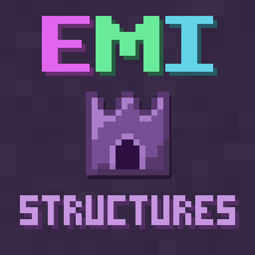

# EMI Structures

  

EMI Structures is a NeoForge and Fabric addon that adds adaptive structure information to [EMI](https://github.com/emilyploszaj/emi). It discovers supported structures from the active game, mods, and datapacks, then shows where each structure generates and which materials it can contain.

Instead of registering a separate recipe for every block and structure combination, each structure has one recipe with its own material pages. EMI's normal recipe and usage lookups both lead to that same entry.

## Features

- Discovers supported structures at runtime instead of relying on a fixed vanilla list.
- Shows the structure's source mod, dimension, biomes, and placement information.
- Shows materials with practical estimated quantities based on multiple lightweight analysis passes.
- Works with data-driven jigsaw structures added by mods and datapacks.
- Keeps container loot out of the results so it does not duplicate dedicated EMI loot addons.
- Does not add, remove, or alter world generation.

## Requirements

- Minecraft 1.21.1
- NeoForge 21.1 or newer, or Fabric Loader 0.16.14 or newer with Fabric API
- EMI 1.1.24 or newer

## Using the mod

Use EMI's normal recipe lookup on a material to see structures that can generate it. Open a structure entry to view its generation details and page through its materials.

## Current 0.1 scope

This first release focuses on data-driven jigsaw structures in singleplayer and integrated-server environments. Initial analysis time depends on the number and complexity of the structures installed.

Dedicated-server synchronization and rebuilding after a datapack reload are not yet supported. Support for additional procedural structure types is planned as the project develops.

## Building from source

Clone the repository and run `./gradlew build` (`gradlew.bat build` on Windows). The jars are:

- `neoforge/build/libs/emi-structures-0.1.1+1.21.1-neoforge.jar`
- `fabric/build/libs/emi-structures-0.1.1+1.21.1-fabric.jar`

Java 21 is required. Shared code lives in `common/`. Loader entrypoints and metadata live in `neoforge/` and `fabric/`.

Version properties are defined in `gradle.properties`: `mod_version`, `minecraft_version`, and `loader`. The published version name is `mod_version+minecraft_version` for both loaders; the loader is only a jar suffix.

## License

EMI Structures is licensed under GPL-3.0-only. See [LICENSE](LICENSE) and [THIRD_PARTY_NOTICES.md](THIRD_PARTY_NOTICES.md).
